<picture>
  <source media="(max-width: 640px)" srcset="assets/hero-compact.svg">
  
</picture>

&nbsp;

I'm a full-stack software engineer based in Barcelona. I've been building software for about seven years, first in corporate teams and more recently on products of my own.

Most of my work sits on the backend: Java and Spring Boot services, REST APIs, and the integrations that connect a business to the tools it already runs on. On the frontend I work mainly with Angular and TypeScript, and I want the screens people use every day to be as solid as the services behind them.

I usually start from the problem rather than the stack, and I'm comfortable owning a feature from the data model to the last state of the UI. I like code the next person can change without fear: clear boundaries, tests around the parts that matter, and a written record of why a decision was made, not only what it was.

Lately I've been putting AI agents to work inside real operations. The part I find most interesting is the engineering around them: narrow tools instead of open access, permissions and audit trails, and a person in the loop wherever a mistake would be expensive.

## How I build

The layers I work across and the tools I reach for in each. Requests move left to right; agents work through the same APIs as everything else, never around them.

<picture>
  <source media="(max-width: 640px)" srcset="assets/architecture-compact.svg">
  
</picture>

## Selected work

### [WeRiders Adventures](https://www.weriders-travel.com)

Professional project · TypeScript · Next.js · React Native · Stripe · Code is private

WeRiders organizes guided motorcycle trips. Running a group trip means bookings, payments, travel paperwork and coordination on the road. I've worked across the company's technology: the web platform customers book through, the backend services behind it, features in the mobile app riders use during a trip, and the integrations the business depends on.

### Agent tooling for WeRiders operations

Professional project · TypeScript · Model Context Protocol · Zod · Code is private

A Model Context Protocol server that lets AI assistants help with day-to-day operations without direct access to the database. Each capability is a narrow tool behind its own permission scope; every call is authenticated and audited, and anything that changes money goes through a preview step before it is applied.

### [Tree visit tracker](https://github.com/CristianMingorance07/tree-visits-service)

Technical assessment · TypeScript · Fastify · Vue 3 · SQLite · Vitest · Docker · GitHub Actions

A full-stack service that counts customer visits and plants a tree every N visits, with a live dashboard. Small in scope, built as production code:

- Visit counting and milestone checks run in a single transaction, so concurrent requests can't plant the same tree twice.
- Request validation and the OpenAPI docs come from the same route schemas, so the docs can't drift from the API.
- The milestone threshold can change at runtime without a restart.
- Strict TypeScript on both ends, backend tests, CI on every push, and a [decision log](https://github.com/CristianMingorance07/tree-visits-service/blob/main/DECISIONS.md) explaining the trade-offs.

## Activity

<picture>
  <source media="(max-width: 640px)" srcset="assets/activity-compact.svg">
  
</picture>

Generated daily from the GitHub API by a workflow in this repository. No third-party services.
